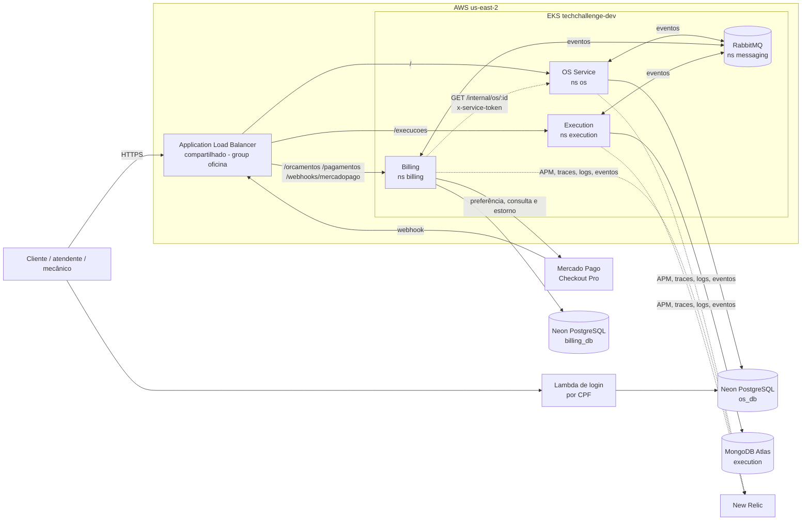
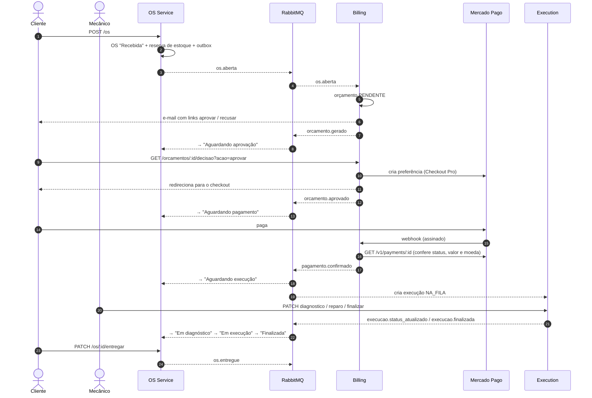
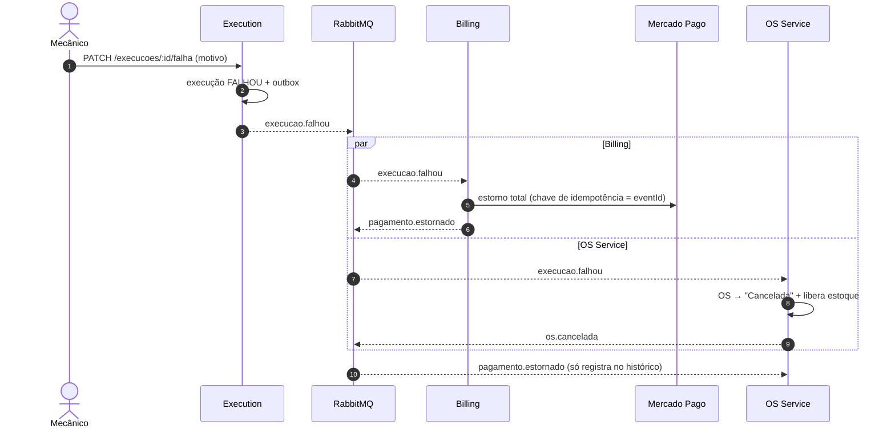
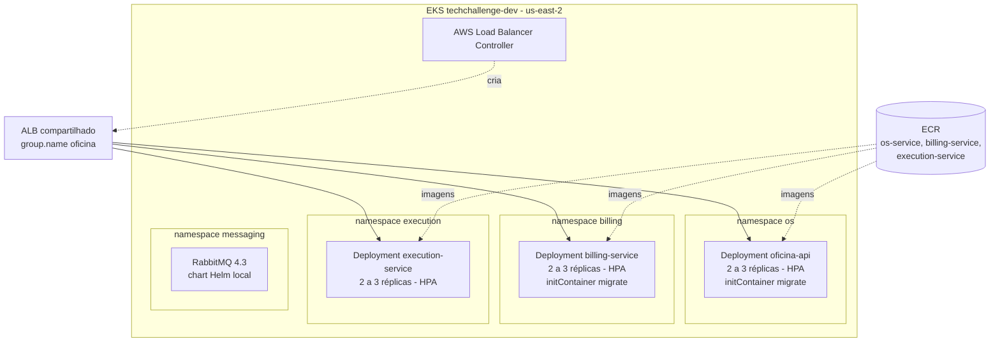
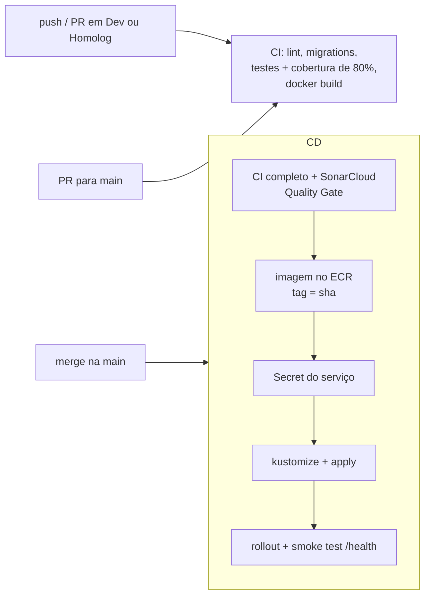

# Arquitetura de Microsserviços — Fase 4

**Tech Challenge FIAP | Plataforma de Oficina e Ordens de Serviço**

| Campo | Valor |
|---|---|
| Versão | 2.0 (Fase 4: monólito → microsserviços) |
| Data | 17 de outubro de 2026 |
| Autor | Bruno Augusto Mathias |
| Estado | Implementada e validada na AWS (EKS), com pagamentos reais no sandbox do Mercado Pago |
| Documento anterior | [Documentacao_Arquitetura_TechChallenge.md](Documentacao_Arquitetura_TechChallenge.md) (v1.0, monólito). As decisões ADR-001 a ADR-007 continuam válidas para cada serviço |
| Decisões desta fase | [adr/](adr/README.md) (ADR-008 a ADR-015) |

## Sumário

1. [Contexto e requisitos](#1-contexto-e-requisitos)
2. [Visão geral](#2-visão-geral)
3. [Responsabilidades e dados de cada serviço](#3-responsabilidades-e-dados-de-cada-serviço)
4. [Comunicação entre serviços](#4-comunicação-entre-serviços)
5. [Saga da ordem de serviço](#5-saga-da-ordem-de-serviço)
6. [Garantias de mensageria](#6-garantias-de-mensageria)
7. [Implantação](#7-implantação)
8. [Segurança](#8-segurança)
9. [Observabilidade](#9-observabilidade)
10. [CI/CD e qualidade](#10-cicd-e-qualidade)
11. [Validação](#11-validação)
12. [Limitações e próximos passos](#12-limitações-e-próximos-passos)

---

## 1. Contexto e requisitos

Até a Fase 3, a oficina era um monólito Node.js com um único banco PostgreSQL. A Fase 4 pede:

| Requisito | Como foi atendido |
|---|---|
| Pelo menos 3 microsserviços, cada um com repositório, banco e pipeline próprios | OS Service, Billing e Execution, em 3 repositórios, cada um com banco e CI/CD independentes |
| Pelo menos um banco SQL e um NoSQL | PostgreSQL (Neon) no OS e no Billing; MongoDB (Atlas) no Execution |
| Mensageria e Saga com compensação | RabbitMQ, saga coreografada, 4 cenários de compensação |
| Testes BDD | Cenários Gherkin em português (jest-cucumber) nos 3 serviços |
| Cobertura de testes de 80% ou mais | Entre 97% e 98% de linhas e entre 84% e 86% de branches |
| Análise estática no CI | SonarCloud com Quality Gate, que bloqueia o deploy |
| Deploy em Kubernetes | EKS, um namespace por serviço, Kustomize e CD por GitHub Actions |
| Branch main protegida | Ruleset do GitHub em `main` e `Homolog`: PR e CI obrigatórios |

## 2. Visão geral

### Repositórios

| Repositório | Conteúdo |
|---|---|
| [TechChallengerFiap-Application](https://github.com/BrunoAmathias/TechChallengerFiap-Application) | OS Service (`backEnd/`), contratos de eventos, observabilidade e documentação geral |
| [TechChallengerFiap-Billing](https://github.com/BrunoAmathias/TechChallengerFiap-Billing) | Billing Service (orçamento e pagamento) |
| [TechChallengerFiap-Execution](https://github.com/BrunoAmathias/TechChallengerFiap-Execution) | Execution Service (fila e etapas da oficina) |
| [TechChallengerFiap-K8s](https://github.com/BrunoAmathias/TechChallengerFiap-K8s) | Terraform: EKS, RabbitMQ, ECR, namespaces e Secrets compartilhados |
| [TechChallengerFiap-DB](https://github.com/BrunoAmathias/TechChallengerFiap-DB) | Terraform: bancos Neon (`os_db`, `billing_db`) e MongoDB Atlas |
| [TechChallengerFiap-ServerLess](https://github.com/BrunoAmathias/TechChallengerFiap-ServerLess) | Lambda de autenticação de clientes por CPF |

## 3. Responsabilidades e dados de cada serviço

| Serviço | Responsabilidade | Fonte da verdade | Banco |
|---|---|---|---|
| **OS Service** | Clientes, veículos, serviços, peças e estoque; abertura e ciclo de vida da OS; histórico de status; entrega | Status da OS e estoque | PostgreSQL `os_db`: `ordens_servico`, `os_historico`, cadastros, `outbox`, `processed_events` |
| **Billing** | Orçamento, link de aprovação ou recusa por e-mail, pagamento no Mercado Pago, expiração e estorno | Orçamento e pagamento | PostgreSQL `billing_db`: `orcamentos` (itens em JSONB), `pagamentos`, `outbox`, `processed_events` |
| **Execution** | Fila de trabalho, prioridade, etapas (diagnóstico, reparo, finalização), tempos e métricas | Execução física do serviço | MongoDB: `execucoes` (com timeline embutida), `outbox`, `processed_events` |

**Regra:** nenhum serviço acessa o banco de outro. A única exceção documentada é a Lambda de login, que lê `clientes` do `os_db` por pertencer ao mesmo contexto de cadastro (ver [eventos.md](../docs/eventos.md#fronteira-com-a-lambda-de-login)).

O MongoDB foi escolhido para o Execution porque a execução é um agregado de documento único: itens, timeline de etapas e técnico mudam juntos, com esquema flexível e leitura frequente da fila ordenada por prioridade ([ADR-012](adr/ADR-012-banco-por-servico.md)).

## 4. Comunicação entre serviços

| Tipo | Uso | Detalhes |
|---|---|---|
| **Assíncrona (eventos)** | Toda mudança de estado entre serviços | RabbitMQ, exchange topic `oficina.events`, routing key = tipo do evento. Contratos em [eventos.md](../docs/eventos.md) |
| **Síncrona (consulta)** | Billing busca detalhes de uma OS quando o evento não trouxe | `GET /internal/os/:id` com header `x-service-token` (Secret `service-auth`) |
| **Externa** | Pagamento | Billing → API do Mercado Pago; Mercado Pago → webhook assinado do Billing |

Os eventos carregam os dados que o próximo passo precisa (por exemplo, `pagamento.confirmado` leva os itens para o Execution montar a fila), o que reduz as chamadas síncronas entre os serviços.

## 5. Saga da ordem de serviço

A saga é **coreografada** ([ADR-009](adr/ADR-009-saga-coreografada.md)): não há orquestrador. Cada serviço reage aos eventos dos outros. O `correlationId` de todos os eventos é o `osId`.

### 5.1 Caminho feliz

### 5.2 Compensações

| Gatilho | Quem publica | Compensações |
|---|---|---|
| Cliente recusa o orçamento | Billing: `orcamento.recusado` | OS → **Cancelada** e devolve o estoque |
| Orçamento impossível (sem itens, sem e-mail, valor divergente) | Billing: `orcamento.falhou` | OS → **Cancelada** e devolve o estoque |
| Pagamento rejeitado ou expirado | Billing: `pagamento.falhou` | OS → **Cancelada** e devolve o estoque |
| Falha na execução (peça indisponível, reparo inviável) | Execution: `execucao.falhou` | Billing **estorna** o pagamento no Mercado Pago (`pagamento.estornado`); OS → **Cancelada** e devolve o estoque |

A máquina de estados completa da OS está em [eventos.md](../docs/eventos.md#máquina-de-estados). "Cancelada" é alcançável de qualquer status antes de "Finalizada".

## 6. Garantias de mensageria

| Problema | Solução |
|---|---|
| Gravar no banco e publicar o evento sem perder nenhum dos dois | **Transactional Outbox** ([ADR-011](adr/ADR-011-outbox-e-idempotencia.md)): o evento vai para a tabela/collection `outbox` na mesma transação da mudança. Um publicador em segundo plano envia com *publisher confirms* e só então marca como publicado |
| Evento entregue mais de uma vez (*at-least-once*) | **Consumo idempotente:** o `eventId` é gravado em `processed_events` na mesma transação do handler. Repetições são confirmadas sem efeito |
| Falha temporária no handler | **Retry** pela fila `<servico>.events.retry` (TTL de 5 s), até 3 tentativas |
| Falha permanente ou mensagem inválida | **DLQ** `<servico>.events.dlq` (via dead-letter exchange `oficina.dlx`) |
| Eventos fora de ordem entre filas | Transição ainda não permitida lança erro e é resolvida pelo retry; evento atrasado (a OS já passou daquele status) é ignorado |
| Duas réplicas publicando o mesmo outbox | Postgres: `FOR UPDATE SKIP LOCKED`; MongoDB: reserva atômica com `findOneAndUpdate` e `lockedUntil` |
| Corrida na mudança de etapa da execução | Controle otimista: `findOneAndUpdate` filtrando pelo status atual (a segunda requisição recebe 409) |

## 7. Implantação

| Item | Detalhe |
|---|---|
| Roteamento | Um ALB para os 3 serviços (`group.name: oficina`). Billing e Execution registram paths específicos com `group.order: 10`; o OS fica com `/` e `group.order: 100` |
| Configuração | ConfigMap por serviço; Secret do serviço (`api-secret`, `billing-secret`, `execution-secret`) criado pelo CD a partir dos GitHub Secrets |
| Infra compartilhada | Terraform do repo K8s cria namespaces, RabbitMQ, ECR e os Secrets `rabbitmq` (`RABBITMQ_URL`) e `service-auth` (`SERVICE_TOKEN`) em cada namespace |
| Bancos | Terraform do repo DB: Neon (`os_db`, `billing_db`, um usuário por banco) e MongoDB Atlas M0 |
| Migrations | `initContainer` com `node-pg-migrate` antes de subir a API (OS e Billing) |
| Probes | `/health/live` (liveness, não depende de dependências externas) e `/health` (readiness) |
| Escala | HPA de 2 a 3 réplicas por serviço; os consumidores são seguros com várias réplicas (idempotência e reserva do outbox) |

## 8. Segurança

- **Autenticação de usuários:** JWT (`Authorization: Bearer`) emitido pelo `/login` do OS Service ou pela Lambda de login por CPF, validado nos 3 serviços com o mesmo `JWT_SECRET`.
- **Serviço a serviço:** header `x-service-token`, com segredo gerado pelo Terraform (`random_password`) e distribuído pelo Secret `service-auth`.
- **Link de aprovação do orçamento:** token HMAC (`APPROVAL_LINK_SECRET`) por orçamento e ação, sem exigir login do cliente.
- **Webhook do Mercado Pago:** assinatura HMAC do header `x-signature`, conferência do pagamento direto na API do Mercado Pago e checagem de **valor e moeda** contra o orçamento. Em sandbox, o modo `MP_WEBHOOK_SIGNATURE=warn` aceita e registra assinaturas inválidas ([ADR-013](adr/ADR-013-mercado-pago.md)); em produção, o modo é `enforce`.
- **Segredos:** nunca na imagem nem no repositório; GitHub Secrets → Secret do Kubernetes no deploy.
- **Contêineres:** `node:20-alpine`, `npm ci --omit=dev`, usuário não root.
- **Dados:** cada serviço só tem credencial do próprio banco (um usuário por banco no Neon e no Atlas).

## 9. Observabilidade

Detalhes em [observabilidade.md](../docs/observabilidade.md).

- **APM por serviço** no New Relic: `oficina-api`, `oficina-billing`, `oficina-execution`.
- **Trace distribuído pela saga:** o contexto do trace viaja no envelope do evento (`traceContext`) e continua no consumidor, apesar do outbox ([ADR-014](adr/ADR-014-trace-distribuido-pelo-envelope.md)). Um webhook do Mercado Pago aparece como um único trace com Billing, OS e Execution.
- **Eventos customizados:** `SagaEvento` (cada evento consumido: processado, retry ou DLQ, com latência), `SagaCompensacao`, `SagaEtapa`, `StatusOS`, `PagamentoDivergente`, `WebhookAssinaturaInvalida`.
- **Logs** JSON (pino) com `correlationId` = `osId`, encaminhados ao New Relic e ligados ao trace.
- **Dashboard** "Oficina - Saga e Microsserviços", versionado em JSON e criado por script.

## 10. CI/CD e qualidade

- Um pipeline por repositório; o deploy de um serviço não depende dos outros ([ADR-015](adr/ADR-015-repositorio-e-pipeline-por-servico.md)).
- O SonarCloud roda só na `main` (dentro do CD) porque o plano gratuito da organização não libera resultados de outras branches. Quality Gate reprovado impede o deploy.
- Fluxo de branches: `Dev` → `Homolog` → `main`, com ruleset em `main` e `Homolog` (PR obrigatório, check de CI obrigatório e atualizado, sem force push nem exclusão).

## 11. Validação

| Validação | Resultado |
|---|---|
| Testes (unitários, funcionais, integração e BDD) | OS 258, Billing 142 e Execution 77 testes; cobertura de linhas entre 97% e 98,5% |
| Saga de ponta a ponta local (3 serviços + RabbitMQ) | 33 verificações em 4 cenários (caminho feliz e compensações) |
| Saga de ponta a ponta na AWS, pelo ALB | 33 verificações, DLQs vazias |
| Pagamentos reais no sandbox do Mercado Pago | OS 44 a 49; as OS 48 e 49 completaram o ciclo até "Entregue" |
| Trace distribuído | Webhook do Mercado Pago com 3 serviços no mesmo trace no New Relic |

## 12. Limitações e próximos passos

- **Ambiente único de desenvolvimento:** a conta AWS está no Free Plan (nós `c7i-flex.large`, RabbitMQ sem volume persistente). Em produção: RabbitMQ em cluster com quorum queues e volume persistente (ou Amazon MQ), e nós dimensionados.
- **HTTPS:** o ALB está em HTTP; o webhook do Mercado Pago usou um túnel Cloudflare temporário. Em produção: certificado ACM e domínio próprio no ALB.
- **Segredos:** o histórico do Git ainda contém segredos antigos (decisão consciente nesta fase). Recomendado: rotacionar e adotar AWS Secrets Manager com External Secrets.
- **Endpoint público do EKS** e listas de IP abertas no Atlas e no Neon, aceitáveis para o ambiente acadêmico.
- **Saga coreografada:** com mais etapas, a visão do fluxo fica espalhada; o histórico da OS, o `SagaEvento` e o trace distribuído mitigam isso. Se a saga crescer, avaliar um orquestrador.
