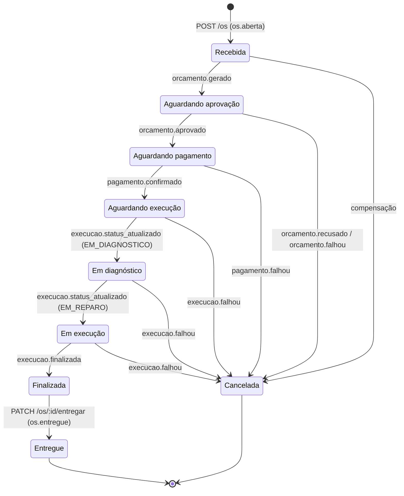

# Contratos de eventos — OS Service

O OS Service participa de uma **saga coreografada**: não existe orquestrador. Cada serviço reage aos eventos dos outros e publica os próprios. O OS Service é a fonte da verdade do **status da OS**.

## Infraestrutura de mensageria

| Item | Valor |
|---|---|
| Broker | RabbitMQ (`rabbitmq.messaging.svc.cluster.local:5672` no EKS) |
| Exchange de eventos | `oficina.events` (topic, durável). A routing key é o `type` do evento |
| Dead-letter exchange | `oficina.dlx` (topic, durável) |
| Fila do OS Service | `os-service.events` |
| Fila de retry | `os-service.events.retry` (TTL `RABBITMQ_RETRY_DELAY_MS`, padrão 5 s; ao expirar, volta para a fila principal) |
| DLQ | `os-service.events.dlq` |

Cada serviço declara a própria fila, retry e DLQ com o mesmo padrão (`<servico>.events`, `.retry`, `.dlq`).

### Garantias

- **Publicação (Transactional Outbox):** o evento é gravado na tabela `outbox` na mesma transação da mudança de negócio. O `OutboxPublisher` faz polling (`FOR UPDATE SKIP LOCKED`), publica com *publisher confirms* e só depois marca `published_at`. A entrega é *at-least-once*.
- **Consumo idempotente:** o `eventId` é inserido em `processed_events` na mesma transação do handler. Um evento repetido é confirmado (ack) sem efeito.
- **Retry:** se o handler falha, a mensagem vai para a fila `.retry` com o header `x-retry-count`. São **3 tentativas** no total; depois disso, vai para a DLQ.
- **Mensagem inválida** (JSON quebrado ou envelope incompleto) vai direto para a DLQ.
- **Ordem:** eventos de filas diferentes podem chegar fora de ordem. Uma transição ainda não permitida (ex.: `pagamento.confirmado` antes de `orcamento.aprovado`) lança erro e é resolvida pelo retry. Evento atrasado (a OS já passou daquele status) ou para OS cancelada é ignorado.

## Envelope (todos os eventos)

```json
{
  "eventId": "6f1c2a4e-1b7d-4c55-9a8e-0d6b3c1f2e90",
  "type": "os.aberta",
  "version": 1,
  "occurredAt": "2026-10-14T23:37:21.279Z",
  "correlationId": "42",
  "source": "os-service",
  "causationId": null,
  "payload": { "osId": 42 }
}
```

| Campo | Descrição |
|---|---|
| `eventId` | UUID v4, chave de idempotência |
| `type` | tipo do evento, igual à routing key |
| `version` | versão do contrato do payload |
| `occurredAt` | ISO-8601 (UTC) |
| `correlationId` | **o `osId`** (string), igual em toda a saga |
| `source` | serviço que publicou (`os-service`, `billing-service`, `execution-service`) |
| `causationId` | `eventId` do evento que causou este, quando houver |
| `payload` | sempre contém `osId` (número) |
| `traceContext` | **opcional.** Cabeçalhos do trace distribuído do New Relic (`traceparent`, `tracestate`, `newrelic`) da transação que gerou o evento. Consumidores devem ignorá-lo se não o usarem |

Propriedades AMQP: `persistent: true`, `contentType: application/json`, `messageId = eventId`, `correlationId`, `type`. Os headers da mensagem levam `source`, `version` e, quando houver, os cabeçalhos do `traceContext`. Os detalhes estão em [observabilidade.md](observabilidade.md).

---

## Eventos publicados pelo OS Service

### `os.aberta` (v1)

Publicado no `POST /os`, depois de gravar a OS como **Recebida** e reservar o estoque. O Billing consome para gerar o orçamento e enviar o e-mail de aprovação, sem precisar chamar o OS Service.

```json
{
  "osId": 42,
  "valorTotal": 180,
  "cliente": { "id": 1, "nome": "Maria", "email": "maria@email.com", "telefone": "11999999999", "documento": "52998224725" },
  "veiculo": { "id": 3, "placa": "ABC1D23", "marca": "VW", "modelo": "Gol", "ano": 2019 },
  "servicos": [{ "servicoId": 1, "nome": "Troca de óleo", "descricao": "Óleo 5w30", "quantidade": 1, "valorUnitario": 120, "total": 120 }],
  "pecas": [{ "pecaId": 4, "nome": "Filtro", "descricao": "Filtro de óleo", "quantidade": 2, "valorUnitario": 30, "total": 60 }]
}
```

### `os.cancelada` (v1)

Publicado quando uma compensação cancela a OS e devolve o estoque.

```json
{
  "osId": 42,
  "statusAnterior": "Aguardando aprovação",
  "motivo": "Orçamento recusado pelo cliente: achou caro",
  "eventoOrigem": "orcamento.recusado",
  "pecasLiberadas": [{ "pecaId": 4, "quantidade": 2 }]
}
```

### `os.entregue` (v1)

Publicado no `PATCH /os/:id/entregar` (Finalizada → Entregue).

```json
{ "osId": 42, "entregueEm": "2026-10-15T14:00:00.000Z" }
```

---

## Eventos consumidos pelo OS Service

O OS Service usa apenas `payload.osId` e os campos marcados abaixo. Os payloads completos estão nos contratos de quem publica: `TechChallengerFiap-Billing/docs/eventos.md` e `TechChallengerFiap-Execution/docs/eventos.md`.

| Evento | Publicado por | Efeito na OS | Campos usados |
|---|---|---|---|
| `orcamento.gerado` | Billing | → **Aguardando aprovação** | – |
| `orcamento.aprovado` | Billing | → **Aguardando pagamento** | – |
| `pagamento.confirmado` | Billing | → **Aguardando execução** | – |
| `execucao.status_atualizado` | Execution | `EM_DIAGNOSTICO` → **Em diagnóstico**; `EM_REPARO` → **Em execução** (inicia os serviços); `NA_FILA` não altera a OS | `status`, `tecnico` (opcional) |
| `execucao.finalizada` | Execution | → **Finalizada** (finaliza os serviços) | – |
| `orcamento.falhou` | Billing | **compensação**: → Cancelada + libera estoque | `motivo` (opcional) |
| `orcamento.recusado` | Billing | **compensação**: → Cancelada + libera estoque | `motivo` (opcional) |
| `pagamento.falhou` | Billing | **compensação**: → Cancelada + libera estoque | `motivo` (opcional) |
| `execucao.falhou` | Execution | **compensação**: → Cancelada + libera estoque (o Billing estorna em paralelo) | `motivo` (opcional) |
| `pagamento.estornado` | Billing | só registra no histórico (a OS já está Cancelada) | `valor` (opcional) |

Toda mudança é gravada em `os_historico`, com origem (`source` do evento), `eventId` e observação, e pode ser consultada em `GET /os/:id/historico`.

## Máquina de estados



"Cancelada" é alcançável de qualquer status **antes de Finalizada**, inclusive "Em execução", porque o reparo pode se mostrar inviável.

## API síncrona (somente consulta)

`GET /internal/os/:id` devolve a OS com cliente, veículo, serviços e peças. Ela é para o Billing e o Execution, quando precisam de detalhes que não vieram no evento.

- Autenticação: header `x-service-token` com o `SERVICE_TOKEN` compartilhado (Secret `service-auth` em cada namespace, gerado pelo Terraform do repo K8s).
- Endereço no cluster: `http://api-service.os.svc.cluster.local:3000/internal/os/:id`.
- Nenhum serviço acessa o banco de outro.

## Fronteira com a Lambda de login

A Lambda de login por CPF (repo `TechChallengerFiap-ServerLess`) lê a tabela `clientes` do banco do OS Service. Ela é tratada como parte do mesmo *bounded context* (cadastro de clientes, mesmo dono), por isso esse acesso não viola a regra de "nenhum serviço acessa o banco de outro". Se a Lambda passar a ser de outro time, a alternativa é ela chamar uma rota `GET /internal/clientes/cpf/:cpf` com o `SERVICE_TOKEN`.
